# ci-onboarding-test-cc

A pnpm workspace with a very large, deep task graph, run with Nx and Nx Cloud CI. It is a lab
for stretching Nx Cloud CI.

- **264 projects**: 52 hand-written ones (43 libraries, 6 apps, 3 e2e suites) and 212
  generated ones (200 modules, 10 domain libraries, the `gateway` app and its e2e suite)
- **1,243 dependency edges between projects**, and a longest path of **36 tasks**
- **1,108 tasks** in a full CI run, with **3,877 edges** between them

| Target        | Tasks | Notes                                                     |
| ------------- | ----: | --------------------------------------------------------- |
| `lint`        |   264 |                                                           |
| `typecheck`   |   264 |                                                           |
| `build`       |   260 |                                                           |
| `test`        |   260 | includes CPU-heavy, memory-heavy, slow and flaky tests    |
| `codegen`     |    51 | `@ci/schema` and the 50 slow modules                      |
| `e2e`         |     4 | api, web and gateway run against continuous `serve` tasks |
| `serve`       |     3 | continuous: `@ci/api`, `@ci/web`, `@ci/gateway`           |
| `env-check`   |     1 | checks the stored secret and variable reach a worker      |
| `secret-echo` |     1 | prints the stored secret, to see what the logs redact     |

## Getting started

```sh
pnpm install
pnpm run check      # every task in the workspace
pnpm run affected   # only what your branch changed
pnpm run graph      # explore the project graph
```

Heavy tests read their size from the environment, and default to small values locally:

| Variable              | Default (local / CI) | Effect                                        |
| --------------------- | -------------------- | --------------------------------------------- |
| `CI_LAB_CPU_SECONDS`  | 5 / 5                | how long CPU-heavy tests keep every core busy |
| `CI_LAB_MEM_MB`       | 2048 / 2048          | how much memory memory-heavy tests hold       |
| `CI_LAB_SLOW_SECONDS` | 3 / 3                | how long slow tests hash on one core          |
| `CI_LAB_FLAKE_RATE`   | 0 / 0.05             | chance that each flaky test fails             |

## How the tasks depend on each other

Packages resolve each other through `exports` that point at `dist/`. So most tasks need the
dependencies to be built first. `nx.json` and the `nx` field of each `package.json` model this:

| Task          | Depends on                                                    | Cached |
| ------------- | ------------------------------------------------------------- | ------ |
| `codegen`     | nothing                                                       | yes    |
| `build`       | `build` of every dependency (+ `codegen` where there is one)  | yes    |
| `typecheck`   | `build` of every dependency (+ `codegen` where there is one)  | yes    |
| `test`        | `build` of every dependency (+ `codegen` where there is one)  | yes    |
| `e2e`         | `build` of every dependency, and the app's continuous `serve` | yes    |
| `serve`       | the app's own `build`                                         | no     |
| `lint`        | nothing (lint is not type-aware)                              | yes    |
| `env-check`   | nothing                                                       | no     |
| `secret-echo` | nothing                                                       | yes    |

`codegen` writes into `src/generated/`, which is not committed: `@ci/schema` turns
`schemas/*.json` into TypeScript, and the slow modules emit 150 type-heavy files each.

Projects are tagged `type:lib`, `type:app` or `type:e2e`. Libraries also get `scope:<folder>`,
and the generated modules get `domain:<domain>` and `kind:<light|slow|cpu|mem|flaky|domain>`.

## The generated modules

`tools/lab/generate-modules.mjs` writes `packages/modules`, `apps/gateway` and
`apps/gateway-e2e`. Change its settings (domains, modules per domain, kinds, seed) and run:

```sh
node tools/lab/generate-modules.mjs && pnpm install && pnpm run format
```

Each domain has 20 modules: 11 light, 5 slow, 2 CPU-heavy, 2 memory-heavy and 2 flaky. A module
depends on 1 to 3 hand-written libraries, often on earlier modules of its domain, and sometimes
on a module of the domain before. Each domain library depends on all of its modules, and the
gateway depends on every domain library.

## CI

CI runs on Nx Cloud CI from `.nx/pipelines/`. The pipeline is a lab for Nx Cloud CI, so it
uses as much of the [pipeline schema](https://nx.dev/docs/reference/nx-cloud/ci-config) as it can:

| File                    | What it does                                                                        |
| ----------------------- | ----------------------------------------------------------------------------------- |
| `ci.yaml`               | The `CI` pipeline: `lint`, `main`, `e2e`, `gateway-smoke`, `cli-smoke` and `report` |
| `format.yaml`           | The `Format` pipeline: Prettier, only when a formatted file changes                 |
| `launch-templates.yaml` | `lab-small`, `lab-medium` and `lab-large` machines                                  |
| `workers.yaml`          | `pr`: 5 to 16 workers sized by the work; `e2e`: 3 fixed; `smoke`: 3                 |
| `ultracache.yaml`       | Paths Ultracache ignores                                                            |
| `steps/report/`         | A custom step template, with a `post` script that reads its saved state             |

The pipeline reads stored variables from the Nx Cloud workspace settings
(**Environment variables**). `@ci/config:env-check` runs on a `lab-small` worker and fails if
the first two don't arrive:

| Name                 | Kind     | Checked how / used for                           |
| -------------------- | -------- | ------------------------------------------------ |
| `CI_LAB_SECRET`      | secret   | SHA-256 compared with the one in `env-check.mjs` |
| `CI_LAB_VAR`         | variable | must be `nx-cloud-ci-lab`                        |
| `CI_LAB_FLAKE_RATE`  | variable | optional, overrides the CI flake rate            |
| `CI_LAB_CPU_SECONDS` | variable | optional, overrides how long CPU-heavy tests run |
| `CI_LAB_MEM_MB`      | variable | optional, overrides how much memory tests hold   |

`CI_LAB_SECRET` is a throwaway lab value: the `main` job and `@ci/config:secret-echo` print it
on purpose, to check what Nx Cloud CI redacts.

`.github/workflows/ci.yml` still runs the same scripts on GitHub Actions, through Nx.

## Layout

| Folder              | What is in it                                                      |
| ------------------- | ------------------------------------------------------------------ |
| `packages/shared`   | Base libraries: types, utils, errors, validation, config and so on |
| `packages/platform` | Infrastructure: db, cache, http, auth, queue, events, metrics      |
| `packages/features` | Domain features: users, billing, orders, shipping, reports         |
| `packages/ui`       | UI building blocks                                                 |
| `packages/client`   | The SDK and its mocks                                              |
| `packages/modules`  | Generated modules and domain libraries                             |
| `apps`              | api, worker, scheduler, web, admin, cli, gateway and e2e suites    |
| `tools/lab`         | The module generator and the slow modules' codegen                 |

Each library exports a `ModuleInfo` that lists its dependencies at runtime. Each test
checks the direct dependencies, the depth and the full set of transitive dependencies. So
if the package graph and the imports drift apart, the tests fail.

## Hand-written projects

| Project               | Path                                | Depth | Direct deps | Transitive deps |
| --------------------- | ----------------------------------- | ----: | ----------: | --------------: |
| `@ci/types`           | `packages/shared/types`             |     0 |           0 |               0 |
| `@ci/constants`       | `packages/shared/constants`         |     1 |           1 |               1 |
| `@ci/utils`           | `packages/shared/utils`             |     1 |           1 |               1 |
| `@ci/date`            | `packages/shared/date`              |     2 |           2 |               3 |
| `@ci/errors`          | `packages/shared/errors`            |     2 |           2 |               3 |
| `@ci/logger`          | `packages/shared/logger`            |     2 |           2 |               3 |
| `@ci/ui-tokens`       | `packages/ui/ui-tokens`             |     2 |           2 |               3 |
| `@ci/crypto`          | `packages/shared/crypto`            |     3 |           2 |               4 |
| `@ci/i18n`            | `packages/shared/i18n`              |     3 |           3 |               4 |
| `@ci/result`          | `packages/shared/result`            |     3 |           2 |               4 |
| `@ci/ui-primitives`   | `packages/ui/ui-primitives`         |     3 |           2 |               4 |
| `@ci/ui-components`   | `packages/ui/ui-components`         |     4 |           4 |               7 |
| `@ci/ui-layout`       | `packages/ui/ui-layout`             |     4 |           3 |               7 |
| `@ci/validation`      | `packages/shared/validation`        |     4 |           3 |               5 |
| `@ci/config`          | `packages/shared/config`            |     5 |           4 |               7 |
| `@ci/serializer`      | `packages/shared/serializer`        |     5 |           3 |               6 |
| `@ci/ui-charts`       | `packages/ui/ui-charts`             |     5 |           3 |               9 |
| `@ci/cache`           | `packages/platform/cache`           |     6 |           4 |               9 |
| `@ci/events`          | `packages/platform/events`          |     6 |           3 |               8 |
| `@ci/http`            | `packages/platform/http`            |     6 |           5 |               9 |
| `@ci/schema`          | `packages/shared/schema`            |     6 |           3 |               7 |
| `@ci/db`              | `packages/platform/db`              |     7 |           6 |              10 |
| `@ci/metrics`         | `packages/platform/metrics`         |     7 |           4 |              10 |
| `@ci/ui-forms`        | `packages/ui/ui-forms`              |     7 |           4 |              13 |
| `@ci/auth`            | `packages/platform/auth`            |     8 |           5 |              14 |
| `@ci/feature-flags`   | `packages/platform/feature-flags`   |     8 |           4 |              13 |
| `@ci/inventory`       | `packages/features/inventory`       |     8 |           5 |              13 |
| `@ci/storage`         | `packages/platform/storage`         |     8 |           4 |              13 |
| `@ci/tracing`         | `packages/platform/tracing`         |     8 |           3 |              13 |
| `@ci/queue`           | `packages/platform/queue`           |     9 |           5 |              16 |
| `@ci/sdk`             | `packages/client/sdk`               |     9 |           5 |              15 |
| `@ci/users`           | `packages/features/users`           |     9 |           6 |              16 |
| `@ci/audit`           | `packages/features/audit`           |    10 |           5 |              21 |
| `@ci/billing`         | `packages/features/billing`         |    10 |           6 |              18 |
| `@ci/cli`             | `apps/cli`                          |    10 |           5 |              16 |
| `@ci/notifications`   | `packages/features/notifications`   |    10 |           5 |              23 |
| `@ci/sdk-mocks`       | `packages/client/sdk-mocks`         |    10 |           3 |              16 |
| `@ci/web`             | `apps/web`                          |    10 |           6 |              23 |
| `@ci/orders`          | `packages/features/orders`          |    11 |           6 |              23 |
| `@ci/payments`        | `packages/features/payments`        |    11 |           5 |              21 |
| `@ci/web-e2e`         | `apps/web-e2e`                      |    11 |           2 |              25 |
| `@ci/analytics`       | `packages/features/analytics`       |    12 |           5 |              24 |
| `@ci/search`          | `packages/features/search`          |    12 |           4 |              24 |
| `@ci/shipping`        | `packages/features/shipping`        |    12 |           5 |              24 |
| `@ci/recommendations` | `packages/features/recommendations` |    13 |           5 |              27 |
| `@ci/reports`         | `packages/features/reports`         |    13 |           6 |              27 |
| `@ci/admin`           | `apps/admin`                        |    14 |           7 |              35 |
| `@ci/api`             | `apps/api`                          |    14 |          17 |              34 |
| `@ci/scheduler`       | `apps/scheduler`                    |    14 |           6 |              28 |
| `@ci/worker`          | `apps/worker`                       |    14 |           8 |              31 |
| `@ci/admin-e2e`       | `apps/admin-e2e`                    |    15 |           2 |              37 |
| `@ci/api-e2e`         | `apps/api-e2e`                      |    15 |           2 |              37 |

## Graph

```mermaid
flowchart BT
  subgraph shared
    types["types"]
    constants["constants"]
    utils["utils"]
    errors["errors"]
    result["result"]
    logger["logger"]
    validation["validation"]
    config["config"]
    crypto["crypto"]
    serializer["serializer"]
    date["date"]
    i18n["i18n"]
    schema["schema"]
  end
  subgraph platform
    events["events"]
    cache["cache"]
    db["db"]
    http["http"]
    metrics["metrics"]
    tracing["tracing"]
    auth["auth"]
    queue["queue"]
    storage["storage"]
    featureFlags["feature-flags"]
  end
  subgraph features
    users["users"]
    billing["billing"]
    payments["payments"]
    inventory["inventory"]
    orders["orders"]
    shipping["shipping"]
    notifications["notifications"]
    search["search"]
    analytics["analytics"]
    recommendations["recommendations"]
    reports["reports"]
    audit["audit"]
  end
  subgraph ui
    uiTokens["ui-tokens"]
    uiPrimitives["ui-primitives"]
    uiLayout["ui-layout"]
    uiComponents["ui-components"]
    uiForms["ui-forms"]
    uiCharts["ui-charts"]
  end
  subgraph client
    sdk["sdk"]
    sdkMocks["sdk-mocks"]
  end
  subgraph apps
    api["api"]
    worker["worker"]
    scheduler["scheduler"]
    web["web"]
    admin["admin"]
    cli["cli"]
    apiE2e["api-e2e"]
    webE2e["web-e2e"]
    adminE2e["admin-e2e"]
  end
  constants --> types
  utils --> types
  errors --> utils
  errors --> constants
  result --> utils
  result --> errors
  logger --> utils
  logger --> constants
  validation --> utils
  validation --> result
  validation --> errors
  config --> utils
  config --> validation
  config --> constants
  config --> logger
  crypto --> utils
  crypto --> errors
  serializer --> utils
  serializer --> validation
  serializer --> result
  date --> utils
  date --> constants
  i18n --> utils
  i18n --> constants
  i18n --> date
  schema --> utils
  schema --> validation
  schema --> serializer
  events --> utils
  events --> logger
  events --> serializer
  cache --> utils
  cache --> logger
  cache --> serializer
  cache --> config
  db --> utils
  db --> config
  db --> logger
  db --> errors
  db --> validation
  db --> schema
  http --> utils
  http --> logger
  http --> config
  http --> serializer
  http --> errors
  metrics --> utils
  metrics --> events
  metrics --> logger
  metrics --> date
  tracing --> utils
  tracing --> metrics
  tracing --> http
  auth --> utils
  auth --> crypto
  auth --> db
  auth --> cache
  auth --> http
  queue --> utils
  queue --> events
  queue --> db
  queue --> serializer
  queue --> tracing
  storage --> utils
  storage --> db
  storage --> cache
  storage --> crypto
  featureFlags --> utils
  featureFlags --> config
  featureFlags --> cache
  featureFlags --> metrics
  users --> utils
  users --> auth
  users --> db
  users --> validation
  users --> events
  users --> schema
  billing --> utils
  billing --> users
  billing --> db
  billing --> events
  billing --> date
  billing --> schema
  payments --> utils
  payments --> billing
  payments --> crypto
  payments --> http
  payments --> featureFlags
  inventory --> utils
  inventory --> db
  inventory --> cache
  inventory --> events
  inventory --> schema
  orders --> utils
  orders --> users
  orders --> inventory
  orders --> billing
  orders --> queue
  orders --> schema
  shipping --> utils
  shipping --> orders
  shipping --> inventory
  shipping --> date
  shipping --> queue
  notifications --> utils
  notifications --> users
  notifications --> queue
  notifications --> i18n
  notifications --> featureFlags
  search --> utils
  search --> inventory
  search --> orders
  search --> cache
  analytics --> utils
  analytics --> metrics
  analytics --> orders
  analytics --> users
  analytics --> date
  recommendations --> utils
  recommendations --> search
  recommendations --> analytics
  recommendations --> users
  recommendations --> featureFlags
  reports --> utils
  reports --> analytics
  reports --> billing
  reports --> date
  reports --> i18n
  reports --> storage
  audit --> utils
  audit --> events
  audit --> users
  audit --> storage
  audit --> tracing
  uiTokens --> utils
  uiTokens --> constants
  uiPrimitives --> utils
  uiPrimitives --> uiTokens
  uiLayout --> utils
  uiLayout --> uiPrimitives
  uiLayout --> i18n
  uiComponents --> utils
  uiComponents --> uiPrimitives
  uiComponents --> i18n
  uiComponents --> date
  uiForms --> utils
  uiForms --> uiComponents
  uiForms --> validation
  uiForms --> schema
  uiCharts --> utils
  uiCharts --> uiComponents
  uiCharts --> uiLayout
  sdk --> utils
  sdk --> http
  sdk --> auth
  sdk --> schema
  sdk --> result
  sdkMocks --> utils
  sdkMocks --> sdk
  sdkMocks --> schema
  api --> utils
  api --> http
  api --> config
  api --> auth
  api --> users
  api --> billing
  api --> payments
  api --> orders
  api --> shipping
  api --> inventory
  api --> notifications
  api --> search
  api --> recommendations
  api --> audit
  api --> metrics
  api --> tracing
  api --> featureFlags
  worker --> utils
  worker --> config
  worker --> queue
  worker --> notifications
  worker --> reports
  worker --> analytics
  worker --> shipping
  worker --> tracing
  scheduler --> utils
  scheduler --> config
  scheduler --> logger
  scheduler --> queue
  scheduler --> reports
  scheduler --> date
  web --> utils
  web --> uiComponents
  web --> uiForms
  web --> uiLayout
  web --> sdk
  web --> i18n
  admin --> utils
  admin --> uiCharts
  admin --> uiForms
  admin --> uiLayout
  admin --> sdk
  admin --> reports
  admin --> analytics
  cli --> utils
  cli --> sdk
  cli --> config
  cli --> logger
  cli --> serializer
  apiE2e --> api
  apiE2e --> sdkMocks
  webE2e --> web
  webE2e --> sdkMocks
  adminE2e --> admin
  adminE2e --> sdkMocks
```

The hand-written projects only. Run `pnpm run graph` for the whole workspace.


